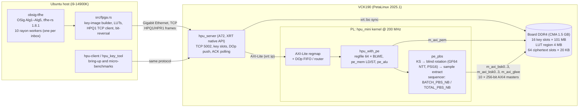
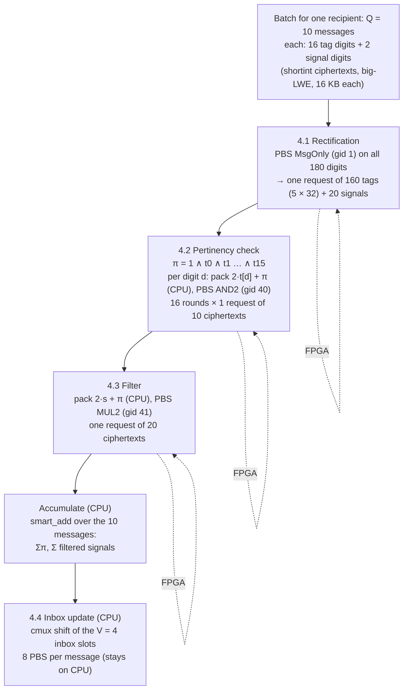
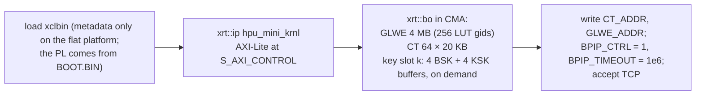
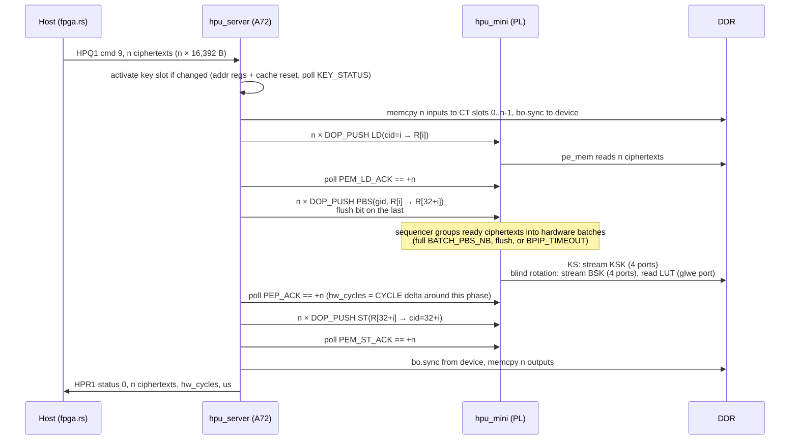
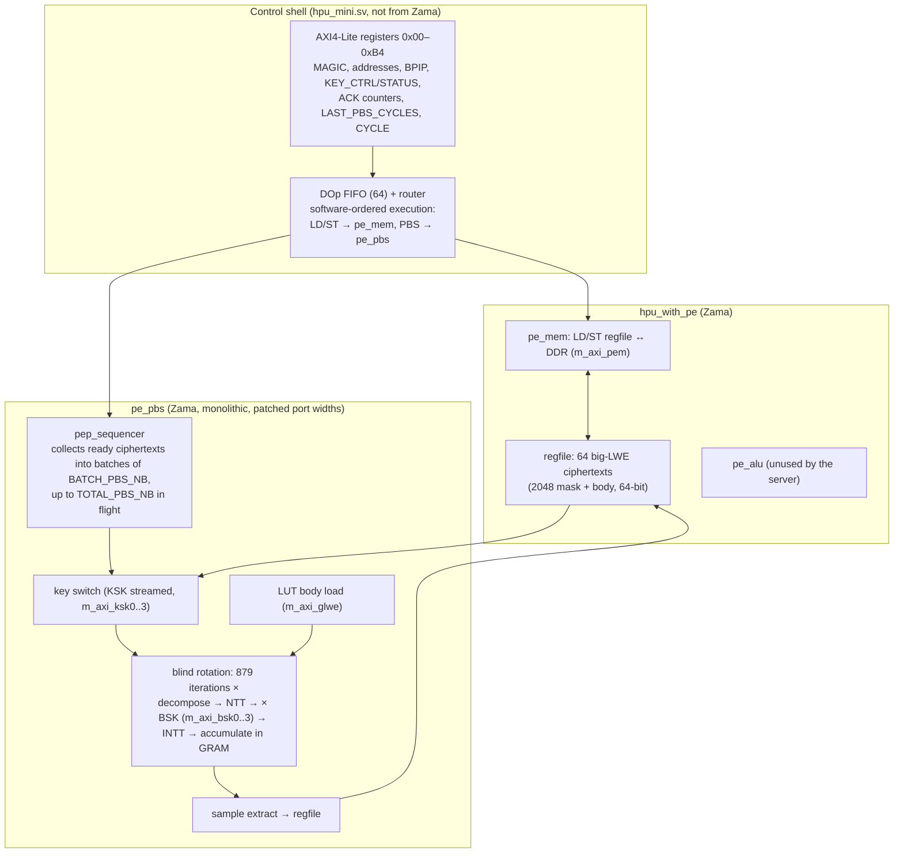
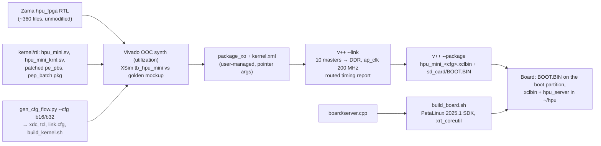

# System architecture — OSig on CPU + VCK190 `hpu_mini`

This document describes how the pieces in this record fit together: what the
host does, what it sends to the board, what the board and the FPGA kernel do,
how the two are connected, and where everything is stored. Numbers refer to
the parameter set used throughout (N=2048, k=1, LWE 879, PBS 23/1, KS 2/8).

## 1. Overview



Division of labour:

| Where | What |
| --- | --- |
| Host CPU | Everything OSig does except the programmable bootstraps of Alg4.1–4.3: key generation (Alg1), signal generation (Alg3), ciphertext packing for bivariate LUTs, `smart_add` accumulation, the inbox update `cmux` (Alg4.4, 1,280 PBS stay on the CPU), decryption (Alg5), timing and validation. |
| Board A72 (`hpu_server`) | Owns the FPGA through XRT: allocates DDR buffers, receives keys and ciphertexts over TCP, writes the key addresses into the kernel, pushes instruction words (DOps), polls acknowledgement counters, returns results. No cryptography. |
| PL (`hpu_mini`) | One processing element doing key switch + blind rotation + sample extraction on big-LWE ciphertexts resident in its register file, with the keys streamed from DDR. 14,400 of the 15,680 PBS of a ten-recipient run execute here. |

## 2. Host side

### 2.1 OSig program (`host/obsig-tfhe`)

`obsig-tfhe` is the oblivious-signalling prototype. One run generates R
recipients with their own TFHE keys (Alg1), Q×G messages per batch (Alg3), then
executes the server step (Alg4) for every recipient inbox in parallel with
rayon, and finally decrypts and checks the inboxes (Alg5). The benchmark number
reported everywhere is the Alg4 wall time.

With `--fpga ip:port` the server step keeps the same algorithm and the same
PBS count but routes three of its four PBS-heavy stages to the board
(`src/server.rs::filter_out_pertinent_message_fpga`):



Per recipient and batch that is 160 + 20 + 160 + 20 = 360 PBS on the board; for
ten recipients and the four batches of the benchmark, 14,400 board PBS in 920
requests. Each rayon worker opens its own TCP connection, so the network
transfer of one worker's request overlaps the board's execution of another's.

`src/fpga.rs` provides:

- **Key images.** For each recipient, a fresh `CompressedServerKey` is
  converted with tfhe-rs' own HPU conversion code into the DDR layout the
  RTL expects: BSK in the GF64 NTT domain split over four "PC" streams
  (4 × 13.7 MiB) and KSK split over four streams (4 × 10.3 MiB). One
  compensation is specific to this RTL snapshot: it orders the big-LWE
  dimension 11-bit bit-reversed, so KSK rows are permuted with `rev11` and
  every ciphertext mask is bit-reversed before upload and after download.
  Images are cached under `wallet/<id>/`. Recipient *i* is uploaded to key
  slot *i* on the board.
- **LUT images.** The built-in `MsgOnly` (gid 1) and two custom bivariate
  LUTs, `AND2` (gid 40) and `MUL2` (gid 41), built like tfhe's
  `create_hpu_lookuptable`. The packing is tfhe's smart bivariate packing
  `v = 2·x + π` with π in the lowest bit, so that a garbage `x` from another
  recipient (padding bit set) still gives 0 when π = 0, exactly as on the CPU.
- **`pbs_batch(slot, gid, cts)`**: up to 32 ciphertexts per request
  (command 9), returning the 32 output ciphertexts; collects `FPGA_STATS`
  (requests, ciphertexts, board cycles, wire time).

### 2.2 Bring-up tools

`hpu-client` speaks the same protocol without any cryptography (register
read-back, key upload from files, test-vector runs with cycle counts).
`hpu_key_tool` produces keys, LUTs and test vectors in the board format with
the same conversion as `fpga.rs`, decrypts board outputs (`verify`) and runs
the single-threaded CPU reference PBS (`bench-cpu`).

## 3. Host ↔ board protocol (HPQ1, TCP 5002)

Request header, 40 bytes big-endian: `"HPQ1"`, `id:u32`, `cmd:u32`, `len:u32`,
`arg0:u64`, `arg1:u64`, `digest:u64` (FNV-1a of the payload), then the payload.
Reply: `"HPR1"`, `id`, `status`, `len`, `hw_cycles:u64`, `us:u64`, `digest`,
payload. Status 3 means a hardware error; the payload is then a register dump.

| cmd | Name | Arguments / payload | Effect on the board |
| --- | --- | --- | --- |
| 1 | PING | — | Returns a register dump (MAGIC, STATUS, ERROR, BPIP regs, KEY_STATUS, ACK counters, LAST_PBS_CYCLES, CYCLE counter). |
| 2 / 3 | KEY_BSK / KEY_KSK | `arg0` = PC index 0..3, `arg1` = key slot 0..15; payload = one key part | Copies into the slot's DDR buffer (allocated lazily, 101 MB per slot), `bo.sync` to device. |
| 4 | LUT | `arg0` = gid; payload = 16 KB GLWE body | Written at `glwe_base + gid × 0x4000`. |
| 5 | KEYS_COMMIT | `arg0` = slot | Marks the slot complete. The kernel switches to a slot on first use: BSK/KSK address registers are rewritten and both key caches are reset (`KEY_CTRL` bits 8 and 10). |
| 6 | PBS | `arg0` = gid \| slot<<16; payload = 1 ciphertext (2049 × u64) | Same as cmd 9 with n = 1. |
| 7 | RESET_CACHE | — | Invalidates the active slot and resets the key caches. |
| 8 | REGDUMP | — | Register dump only. |
| 9 | PBS_BATCH | `arg0` = gid \| slot<<16, `arg1` = n ≤ 32; payload = n ciphertexts | See §4.2. `hw_cycles` = board cycles of the PBS phase. |
| 10 | REG_WRITE | `arg0` ∈ {0x38 BPIP_CTRL, 0x3C BPIP_TIMEOUT}, `arg1` = value | Quasi-static batching registers (added Oct 28). |

## 4. Board side (`board/server.cpp`)

### 4.1 Start-up and storage



DDR layout seen by the kernel (byte addresses, little-endian u64):

| Object | Address | Size |
| --- | --- | --- |
| BSK part q = 0..3 | `BSK_ADDR[q]` (per slot) | 14,401,536 B each (879 loops × 2 GLWE columns × 64 iterations × 2 rows × 64 B) |
| KSK part q = 0..3 | `KSK_ADDR[q]` (per slot) | 10,813,440 B each (3 × 21-bit digits packed in u64) |
| GLWE LUT gid | `GLWE_ADDR + gid × 0x4000` | 16 KB body only, polynomial in bit-reversed order |
| Ciphertext slot cid | `CT_ADDR + cid × 0x5000` | mask a[0..2047] at +0, body at +0x4000; 20 KB stride (page aligned) |

The register file inside the kernel holds 64 big-LWE ciphertexts (R0..R63).
The server uses DDR slots / registers 0..31 for inputs and 32..63 for outputs.

### 4.2 One `PBS_BATCH` request



The server serialises requests with a mutex (one PE), so the ten OSig workers
queue; their TCP transfers overlap the board's execution of the current
request. Register accesses go through XRT (`write_register` ≈ 2 µs), which is
why the batch timeout had to be raised to 1,000,000 cycles: with the old
50 µs, pushing 32 PBS DOps took longer than the timeout and the sequencer
split 32-ciphertext requests into 24 + 8.

## 5. The FPGA kernel (`kernel/rtl/hpu_mini.sv`)

`hpu_mini` assembles unmodified Zama HPU sub-modules and adds a thin control
shell. Configuration: `pem1_glwe1_bsk4_ksk4` (ten 256-bit AXI4 masters), GF64
NTT with R=2, PSI=16 (32 coefficients per cycle), radix cut [5,5,1], KS
`x2y32z3`, register file `reg64_coef32_seq4`, batch package
`bpbs{8,16,32}_tpbs{16,32,48}`.



Batching inside the PE: a PBS DOp becomes a "ready" ciphertext once its
key switch has run. The sequencer launches a hardware batch when
`BATCH_PBS_NB` ciphertexts are ready, when the flush bit of a DOp is seen, or
when `BPIP_TIMEOUT` cycles have elapsed with ciphertexts waiting. Within a
batch the 879 blind-rotation iterations each read one BSK chunk from DDR and
apply it to all ciphertexts of the batch, so the key stream is read once per
batch. Measured behaviour (`data/docs/PERF_BATCH.md`):

| Term | Value at 200 MHz | Origin |
| --- | --- | --- |
| Key stream per batch | ≈ 1.32M cycles = 6.6 ms | 57.6 MB BSK + 43 MB KSK over the eight key ports, ≈ 15 GB/s from DDR |
| Compute per ciphertext | 113.5k cycles = 0.57 ms | 879 iterations × 128 cycles: two N=2048 polynomials through the 32-coefficient/cycle NTT |
| Batch time | max(key stream, n × 113.5k) | key streaming and NTT overlap |
| Crossover | ≈ 12 ciphertexts | above it the kernel is NTT-bound; b16 and b32 give the same per-ciphertext time |

## 6. Build and deployment flow



Golden model used for the XSim regression: Zama's `hpu_mockup` + `hpu_bench
--io-dump` with zero-noise keys, generated for exactly this configuration, so
the test bench compares the kernel's DDR writes bit for bit.

## 7. File map of this record

```
Oct_28_record/
├── README.md            reproduction guide
├── ARCHITECTURE.md      this document
├── images/              BOOT_*.BIN + hpu_mini_*.xclbin (depth 8 / 16 / 32, 200 MHz), uEnv.txt, SHA256SUMS
├── board/               server.cpp, hpu_server (AArch64), run_server.sh, build_board.sh, uEnv.txt
├── host/
│   ├── hpu-client/      Rust client (protocol, test vectors, batch benchmark)
│   ├── hpu_key_tool/    Rust key/LUT/test-vector tool, verify, bench-cpu
│   ├── obsig-tfhe/      OSig prototype with src/fpga.rs
│   ├── bin/             x86-64 builds of the three programs
│   └── scripts/         verify_hw_outputs.sh
├── kernel/              rtl/, kernel.xml, scripts/ (gen_cfg_flow.py, cfg_b16, cfg_b32, v++ flow)
├── keys/                board key images, LUTs, test vectors, test client key
└── data/                perf/ (raw measurements), logs/ (OSig runs), docs/ (working documents)
```
